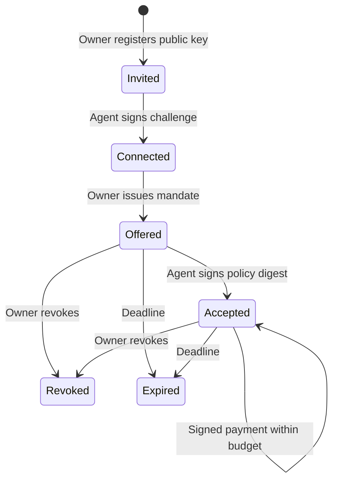

# External-agent delegation prototype

VEIL authorizes an existing agent; it does not create or run an LLM agent.
This implementation adds the missing handoff between owner consent and agent use:
registration, proof of key possession, mandate delivery, explicit signed acceptance,
signed payment requests and authenticated receipt retrieval.

## Try it without credentials

```sh
npm ci
npm run agent:demo
npm run test:agents
```

The demo creates a temporary loopback HTTP server, an ephemeral owner Core and an
independent Ed25519 agent key. It uses real Kit transactions and cryptographic
signatures with injected mock RPC responses. It does not use Helius, fund a wallet,
contact Devnet or broadcast a payment. A printed `confirmed` status is a mock RPC
outcome. The database is in memory for this disposable demonstration.

`client/agent.mjs` is the example external client. Its inputs are its own signing
key, an owner-provided invitation and the server URL. It never receives the owner
session token, Helius key or Solana payer key. No LLM vendor dependency is required.

## Lifecycle



The invitation is single-use and expires after 60 seconds. Replacing an agent key
is not supported implicitly: the owner must revoke the old registration and
explicitly register a new key/identity. Duplicate public-key registration is
rejected, including attempts to silently re-register a revoked key.

A mandate binds its protocol version, stable server audience, agent and key digest,
current Core persona, payer, Devnet/SOL, exact recipient, per-request cap, cumulative
budget, issue time and expiry. Policies are immutable once offered. The agent's
acceptance signs the exact canonical policy digest. Owner approval alone does not
make the mandate executable.

Prototype limits are 0.01 Devnet SOL per request, 0.1 Devnet SOL cumulative budget
per mandate, and a maximum 60-second mandate lifetime. These are transfer amounts;
network fees are outside the budget. A new mandate is a new explicitly approved
budget, not a continuation of a wallet-wide allowance.

## HTTP routes

The existing exact loopback Host and browser Origin checks remain. This prototype
is not a publicly hosted agent gateway. Nonbrowser agents on the same trusted host
use signatures, without an owner session token. Do not treat the bootstrap owner
token as multi-user authentication: trusted local programs can obtain it.

Owner routes require the existing `X-Veil-Session` token and JSON bodies:

| POST path | Body |
| --- | --- |
| `/api/owner/agents/register` | `{ "name": "research-agent", "publicKey": { "kty": "OKP", "crv": "Ed25519", "x": "BASE64URL_PUBLIC_KEY" } }` |
| `/api/owner/agents/offer` | `{ "agentId": "ID", "context": "api", "recipient": "SOLANA_ADDRESS", "maxLamports": "2000", "totalBudgetLamports": "5000", "ttlMs": 60000, "consent": true }` |
| `/api/owner/agents/revoke` | `{ "agentId": "ID" }` |
| `/api/owner/agents/revoke-mandate` | `{ "mandateId": "ID" }` |
| `/api/owner/agents/status` | `{ "agentId": "ID", "requestId": "PAYMENT_REQUEST_ID" }`; permits owner reconciliation after agent revocation |

`GET /api/agent/info` exposes only the protocol, public audience and adapter mode.
All other agent routes require a signed envelope, not an owner token:

| POST path | Signed action | Exact payload fields |
| --- | --- | --- |
| `/api/agent/connect` | `agent.connect` | `challenge` |
| `/api/agent/inbox` | `agent.inbox` | Empty object |
| `/api/agent/accept` | `mandate.accept` | `mandateId`, `policyDigest` |
| `/api/agent/pay` | `payment.request` | `mandateId`, `policyDigest`, `network`, `asset`, `payer`, `recipient`, `lamports` |
| `/api/agent/status` | `payment.status` | `requestId` of the original payment |

Registration returns an invitation containing `agentId`, `audience`, `challenge`,
`expiresAt` and the public-key digest. The owner gives that invitation to the
intended agent over its trusted local integration. Connected agents fetch their
own offers through the signed inbox. There is no webhook/push delivery or remote
TLS/account setup in this slice.

## Signed protocol

The outer envelope has exactly two fields: `message` and `signature`.

```json
{
  "message": {
    "protocol": "VEIL-AGENT-v1",
    "audience": "veil:SERVER_UUID",
    "action": "payment.request",
    "agentId": "AGENT_UUID",
    "requestId": "REQUEST_UUID",
    "issuedAt": 0,
    "expiresAt": 60000,
    "payload": {
      "mandateId": "MANDATE_UUID",
      "policyDigest": "SHA256_HEX",
      "network": "solana:devnet",
      "asset": "SOL",
      "payer": "PAYER_ADDRESS",
      "recipient": "RECIPIENT_ADDRESS",
      "lamports": "1000"
    }
  },
  "signature": "BASE64URL_ED25519_SIGNATURE"
}
```

Times above are schema examples; use actual epoch milliseconds. The issue time
cannot be in the future, expiry must be after the current server time, and the
signed window cannot exceed 60 seconds. Synchronize client/server clocks.

The protocol signs UTF-8 canonical JSON: recursively sort object field names,
preserve array order, and use JSON string encoding. It accepts only JSON strings,
booleans, null and safe integer numbers; lamports are positive canonical decimal
strings. It is a repository-defined versioned encoding, not a claim of general
RFC 8785 support. Ed25519 signatures use unpadded canonical base64url. Unknown
message, envelope, action-payload and public-key fields are rejected.

Use `signAgentRequest` and the example client instead of rebuilding bytes ad hoc.
The server verifies the registered agent key, audience, action, time window and
payload shape, then persists the canonical message digest under agent/request ID.
Reusing an ID with changed contents is rejected. An identical signed payment
request is an idempotent retry. Preserve and resend the **same envelope**, rather
than rebuilding it with a new timestamp or ID. After its signed expiry, use a new
signed status request referencing the original payment ID; do not create a new
payment to check the old one.

## Persistent execution and budgets

The agent path uses SQLite transactions with `BEGIN IMMEDIATE`, WAL and full
synchronous durability. Agent identity, server audience, immutable offers,
acceptance signatures, request digests, budget reservations, payment intents and
transaction signatures are persisted. No agent private key, payer private key,
Helius API key or signed transaction wire bytes are saved in these records.

Budget reservation and request/intent creation happen in one transaction. The
payment executor also atomically reserves an authorized intent before its first
asynchronous operation. This prevents concurrent retries from submitting twice,
including two executor instances sharing the same database. A different signed
request competes against the remaining cumulative budget.

The current Core persona/root, agent registration, accepted mandate and deadlines
are rechecked around preparation and simulation, immediately before submission.
The agent request expiry is an additional deadline. The signature is saved before
the broadcast call. Provider errors are sanitized by the existing transport.

| Outcome | Reservation and retry behavior |
| --- | --- |
| Proven failure before broadcast, no transaction signature | Release transfer reservation once; same intent remains failed |
| Broadcast acknowledgment, pending status or uncertain submission | Hold reservation and reconcile saved signature; never auto-resend |
| Confirmed/finalized payment | Retain consumed budget |
| Included transaction failure, signature present | Conservatively retain budget; fees may have been charged |
| Process stops during preparation | Leave `preparing` and hold reservation; no automatic restart or release |

An interrupted `preparing` record requires manual investigation; an automatic
recovery/release command is intentionally not implemented. Public RPC absence
does not establish non-inclusion. Block-height expiry reconciliation and an
audited refund policy remain future work. HTTP 200 does not mean settled payment:
inspect the receipt's status.

The original owner-only Solana service is still in memory. Persistence here applies
to the external-agent path. The existing Core identity is also ephemeral: restarting
the desktop creates no restored Midnight root. Old persona-bound authority becomes
unusable, but stored budgets/replay records remain. The owner can still reconcile
transaction signatures. Do not delete the database to bypass a budget or uncertain
payment state.

Prototype storage bounds are 200 registered agents, 500 offers, 200 accepted engine
mandates, 500 intents and 10,000 signed request identities. Retention/archival and
production scaling are not implemented.

## Opt-in desktop setup

Follow the Midnight compiler/proof-server setup and dedicated Devnet payer setup
in the root README and [Solana guide](SOLANA-DEVNET.md). In server-side `.env`:

```dotenv
VEIL_SOLANA_ENABLED=1
VEIL_SOLANA_KEYPAIR_PATH=.private/solana-devnet-keypair.json
VEIL_AGENTS_ENABLED=1
VEIL_AGENT_DB_PATH=.private/agents.sqlite
HELIUS_API_KEY=
```

```sh
npm run build
node --env-file=.env server/http.mjs
```

Set Helius's key only on the server if using its Devnet RPC; an empty value uses
the public Devnet RPC. Initialize the Core, register the agent through the owner
API, deliver its invitation, and use the example agent client for signed calls.
This opt-in path can send Devnet transfers if explicitly configured and funded;
the offline demo cannot. No funds or API key were provisioned by this change.

## Remaining boundaries

This is trusted local policy enforcement, not Solana on-chain delegation. The payer
key holder can transact outside VEIL. Current Midnight circuits do not attest this
agent's identity, mandate acceptance or exact Solana payment. Persona state is
checked by the local Core; it is not a cross-chain proof-verification bridge.

SOL transfers expose payer, recipient and amount. Sharing one payer may correlate
personas. No production anonymity, Solana Rings integration, independent agent
runtime, remote multi-user authentication or public cloud deployment is claimed.
Persistent records are local plaintext within a restricted directory, not an
encrypted vault. The owner/Core/signer/server remain trust boundaries.
